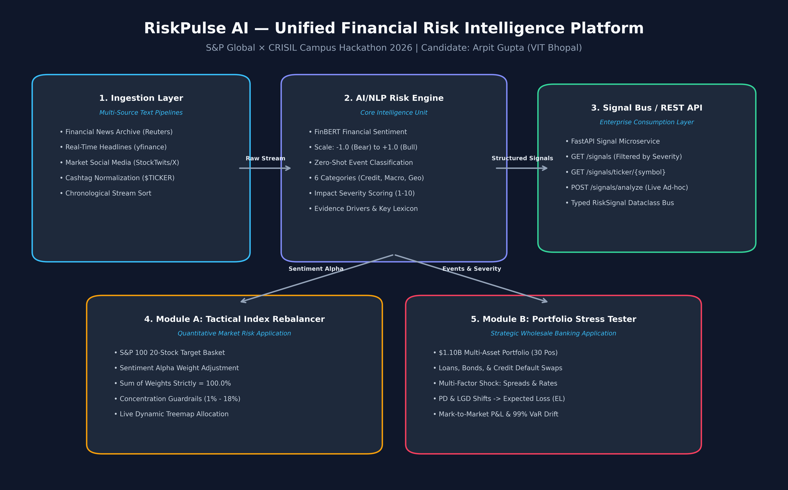

# [RiskPulse AI] - S&P Global & Crisil Campus Hackathon

**Candidate Name:** Arpit Gupta  
**College Email ID:** arpit.23bce10791@vitbhopal.ac.in  
**Personal Email ID:** 2004arpitgupta@gmail.com  
**College / Campus:** Vellore Institute of Technology, Bhopal  
**Demo Video Link:** [YouTube / Unlisted](https://youtu.be/placeholder)  
**Slide Deck Link (if hosted externally):** [docs/presentation.pdf](docs/presentation.pdf)  

---

## 1. Project Overview / Problem Statement & Approach

Modern financial institutions operate in an environment where market-moving risk events originate in high-velocity, unstructured textual data—such as global news feeds, regulatory proceedings, and market social commentary—long before they manifest in backward-looking balance-sheet disclosures. The business challenge is to bridge the latency gap between textual narratives and quantitative risk management frameworks.

**RiskPulse AI** is a production-grade financial risk intelligence platform designed to ingest and parse multi-source unstructured text, converting raw narratives into structured, machine-readable risk signals. The engine computes:
1. **Sentiment Score:** Calibrated numerical score from $-1.0$ (strongly bearish/distressed) to $+1.0$ (strongly bullish/expansionary).
2. **Event Classification:** Categorical taxonomy aligned with CRISIL and S&P risk pillars (Geopolitical, Macroeconomic, Credit Event, Merger/Acquisition, Regulatory, and Product Launch).
3. **Impact Severity Score:** Predicted severity score ($1$ to $10$) based on sentiment magnitude, systemic event multipliers, and market engagement.

To prove the operational viability of the platform, RiskPulse AI implements **both downstream applications**:
- **Module A (Tactical Index Rebalancing):** Dynamically recalibrates constituent weights in an S&P 100 20-stock basket based on sentiment alpha, adhering to institutional concentration bounds ($1\%$ to $18\%$).
- **Module B (Strategic Wholesale Portfolio Stress Testing):** Simulates multi-factor macroeconomic and credit shocks on a $\$1.10\text{B}$ wholesale banking portfolio (loans, bonds, and credit default swaps), quantifying mark-to-market P&L drawdowns, Expected Loss ($EL = EAD \times PD \times LGD$), and $99\%$ Value-at-Risk (VaR) drift.

---

## 2. Architecture & Tech Stack



- **System Design & Data Flow:**
  - **Ingestion Layer (`src/engine/ingestion.py`):** Multi-source ingestion supporting curated financial news archives, live news headlines (`yfinance`), and market social media streams with cashtag normalization (`$TICKER`).
  - **AI/NLP Risk Engine (`src/engine/risk_engine.py`):** Hybrid pipeline combining domain-specific financial sentiment (`ProsusAI/finbert` and specialized financial lexicon), zero-shot classification, and calibrated impact severity scoring.
  - **Signal Bus / REST API (`src/api/signal_api.py`):** FastAPI endpoints (`/signals`, `/signals/ticker/{symbol}`, `/signals/analyze`) enabling downstream systems and microservices to consume signals seamlessly.
  - **Downstream Applications (`src/modules/`):** Vectorized mathematical engines for dynamic portfolio rebalancing and multi-factor credit stress testing.
  - **Interactive Command Center (`app.py`):** Full-featured Streamlit dashboard with real-time feed analytics, interactive Plotly treemaps, stress-test shock simulators, and ad-hoc live text scoring.
- **Key Frameworks & Libraries:**
  - AI/NLP: `transformers`, `torch`, `vaderSentiment`
  - Financial Data & Math: `pandas`, `numpy`, `yfinance`
  - Visualization: `streamlit`, `plotly`
  - API & Testing: `fastapi`, `uvicorn`, `pytest`

---

## 3. Dataset Used

- **Source / Nature of Sample Data:**
  - **Financial News Stream (`data/news_feed_sample.json`):** 40 curated synthetic news articles modeled after Bloomberg and Reuters reporting, covering corporate earnings, regulatory interventions, credit events, and geopolitical developments across major S&P 100 tickers.
  - **Social Media Commentary Stream (`data/social_feed_sample.json`):** 60 structured posts representing StockTwits and X (Twitter) financial discussions with ticker tags, engagement proxies, and trader vernacular.
  - **Wholesale Banking Portfolio (`data/wholesale_portfolio.csv`):** 30 synthetic wholesale banking positions representing a $\$1.119\text{B}$ notional portfolio across Corporate Loans, Investment Grade Bonds, High Yield Bonds, and Credit Default Swaps (protection sold).
- **Assumptions Made:**
  - All data is 100% synthetic or derived from public structures. No proprietary or confidential client information from S&P Global or CRISIL was sourced or used.
  - Wholesale loans and bonds are assumed to be non-amortizing with bullet maturities for duration and spread-impact modeling.

---

## 4. Quickstart & Installation

Runtime: Python 3.10+ / Python 3.11 tested on Windows 11 & Linux.

Step-by-step commands to set up the environment and run your code locally:

```bash
# 1. Clone the repository
git clone https://github.com/4GuptaArpit/vitb-arpit-gupta-hackathon.git
cd vitb-arpit-gupta-hackathon

# 2. (Optional) Create and activate a virtual environment
python -m venv venv
# Windows:
.\venv\Scripts\activate
# Linux/macOS:
source venv/bin/activate

# 3. Install dependencies
pip install -r requirements.txt

# 4. Run automated test suite (100% passing)
python -m pytest -v

# 5. Launch the Interactive RiskPulse AI Command Center
python -m streamlit run app.py
```

*Optional REST API execution:*
```bash
# Launch the FastAPI Signal Bus
uvicorn src.api.signal_api:app --reload --port 8000
# Access interactive Swagger docs at http://localhost:8000/docs
```

---

## 5. Key Results & Domain Impact

- **Quantitative Risk Translation:** Successfully translates unstructured qualitative text into calibrated numeric metrics with sub-second execution, zero external paid API costs, and full offline reproducibility.
- **Module A (Tactical Index Rebalancer):** Demonstrates risk-managed sentiment alpha by dynamically trimming deteriorating assets (e.g., AAPL weight $-1.95\%$ upon regulatory antitrust inquiry) and reallocating to positive momentum constituents (e.g., NVDA $+1.90\%$ on Blackwell demand), strictly preserving regulatory concentration constraints ($\sum w_i = 100.0\%$, floor $1.0\%$, ceiling $18.0\%$).
- **Module B (Strategic Wholesale Stress Tester):** Direct alignment with CRISIL credit rating and Basel stress-testing standards. When a high-impact Geopolitical conflict (Severity 9) is detected, the engine executes multi-factor shocks (credit spread widening $+280\text{ bps}$, PD multiplier $1.75\times$), revealing an immediate mark-to-market drawdown of $-\$133.79\text{M}$ ($-12.13\%$) and a $\$3.27\text{M}$ surge in Expected Loss ($EL$).
- **Institutional Applicability:** Delivers an end-to-end framework enabling credit committees, risk officers, and quantitative portfolio managers to proactively hedge balance-sheet vulnerabilities before lagging financial disclosures are finalized.
